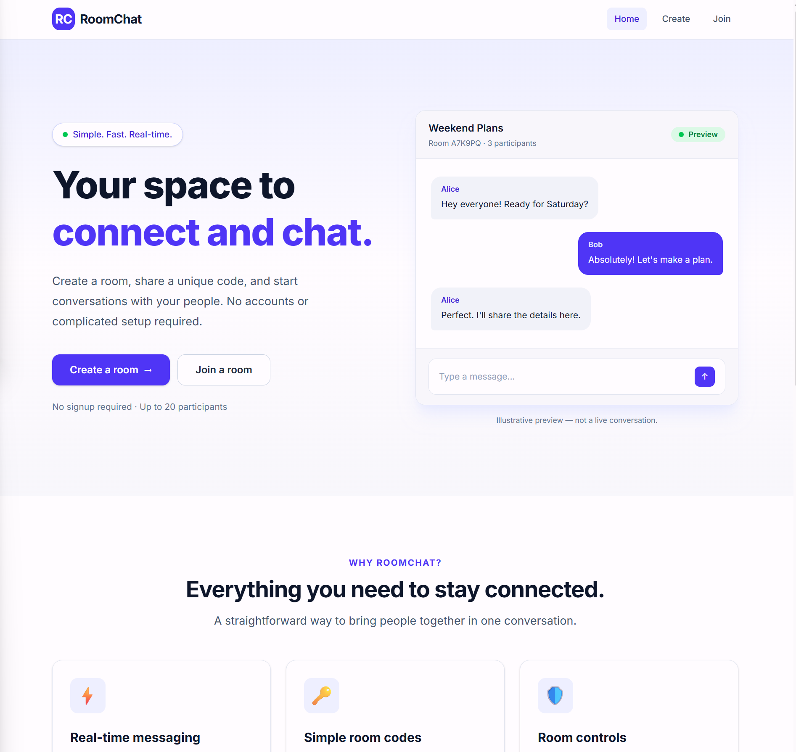
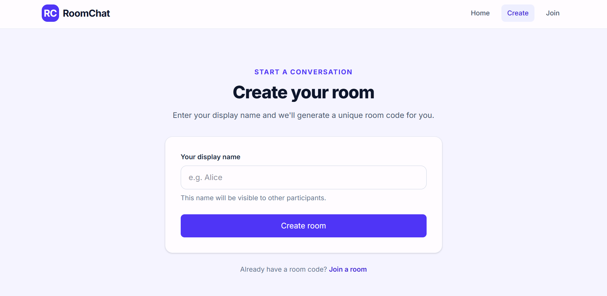
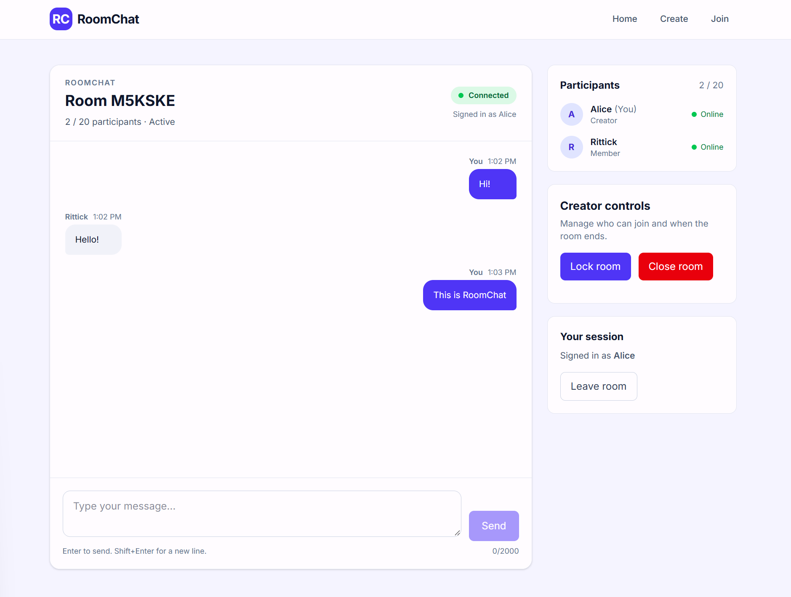
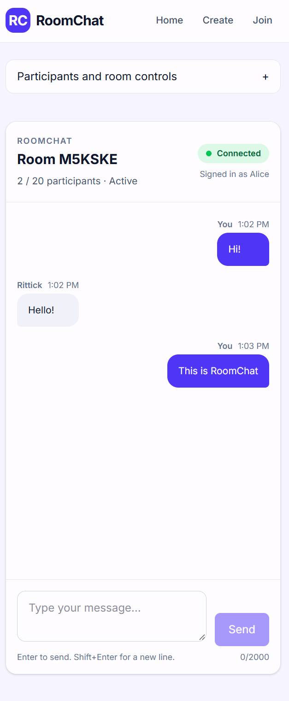

# ChatRoom

**A real-time, room-based chat application built with React, TypeScript, Node.js, Express, and Socket.IO.**

ChatRoom allows users to create temporary chat rooms, share room codes, and exchange messages in real time without creating an account.

**Live Demo:** [Chatroom](https://chatroom-client-eta.vercel.app/)

**Backend Health:** [API Status](https://roomchat-api.onrender.com/health)

## Features

- **Instant room creation:** Create a temporary room with a unique room code.
- **Room-code invitations:** Share a code so other users can join.
- **Real-time messaging:** Send and receive messages instantly using Socket.IO.
- **Participant presence:** See participants join, leave, and disconnect.
- **Creator controls:** Start, lock, and close rooms.
- **Room capacity limits:** Prevent rooms from exceeding their configured participant limit.
- **Input validation:** Validate room codes, display names, and messages.
- **Rate limiting:** Protect room and chat operations against excessive requests.
- **Automatic cleanup:** Expire unused rooms and release server resources.
- **Responsive interface:** Support desktop and mobile browsers.
- **Automated testing:** Cover backend behavior and browser workflows.
- **Production monitoring:** Track server health, connections, and operation outcomes.

## Screenshots

### Landing page



### Room creation



### Real-time chat



### Mobile experience



## Tech Stack

| Layer | Technologies |
|---|---|
| Frontend | React, TypeScript, Vite, Tailwind CSS |
| Routing | React Router |
| Backend | Node.js, Express, TypeScript |
| Real-time communication | Socket.IO |
| Validation | Zod |
| Monorepo | npm workspaces |
| Backend testing | Node.js built-in test runner |
| End-to-end testing | Playwright |
| Logging | Pino |
| Frontend deployment | Vercel |
| Backend deployment | Render |

## Architecture

ChatRoom is organized as an npm-workspaces monorepo.

```text
ChatRoom/
├── apps/
│   ├── client/       # React frontend
│   └── server/       # Express + Socket.IO backend
├── packages/
│   └── shared/       # Shared schemas, types, and constants
├── e2e/              # Playwright browser tests
├── docs/             # Technical documentation
└── package.json
```

The frontend and backend share TypeScript contracts through `@chatroom/shared`, reducing inconsistencies between client requests and server responses.

The backend uses an in-memory room repository. Rooms and messages are temporary and are removed when the server restarts.

See [Architecture Documentation](docs/architecture.md) for more details.

## Getting Started

### Prerequisites

- Node.js 24 or a compatible version supported by the project
- npm
- Git

### Clone the repository

```bash
git clone https://github.com/RittickDatta/full-stack-apps
cd full-stack-apps/ChatRoom
```

If the repository contains ChatRoom in a nested `ChatRoom` directory, change into that directory before running npm commands.

### Install dependencies

```bash
npm ci
```

### Configure environment variables

Create `apps/server/.env`:

```dotenv
NODE_ENV=development
PORT=3001
CLIENT_ORIGIN=http://localhost:5173
```

Add any other variables required by the server configuration, using `apps/server/.env.example` as the source of truth.

Create `apps/client/.env`:

```dotenv
VITE_SOCKET_URL=http://localhost:3001
```

### Start the application

```bash
npm run dev
```

Open:

http://localhost:5173

The backend runs at:

http://localhost:3001

## How to Use

1. Open ChatRoom and select **Create Room**.
2. Enter your display name.
3. Copy the generated room code.
4. Start the room.
5. Share the room code with another user.
6. The other user selects **Join Room** and enters the code.
7. Exchange messages in real time.
8. Use creator controls to lock or close the room.

## Testing

Run TypeScript checks:

```bash
npm run typecheck
```

Build the project:

```bash
npm run build
```

Run backend tests:

```bash
npm run test -w @chatroom/server
```

Run Playwright tests:

```bash
npm run test:e2e
```

Install Playwright browser binaries if required:

```bash
npx playwright install
```

## Security

ChatRoom includes:

- Runtime input validation
- Room creator authorization
- Server-side participant and room membership checks
- Socket.IO origin restrictions
- Rate limiting
- Payload-size limits
- Structured error acknowledgements

ChatRoom is an ephemeral chat application, not an end-to-end encrypted messaging service.

See [Security Documentation](docs/security.md).

## Deployment

The application is deployed using:

- **Vercel:** React frontend
- **Render:** Node.js and Socket.IO backend

The frontend connects to the backend using the `VITE_SOCKET_URL` environment variable.

See [Deployment Documentation](docs/deployment.md).

## Known Limitations

- Rooms and messages are stored in memory.
- Restarting the backend removes active rooms.
- Sessions are not automatically restored after disconnection.
- The backend is designed for a single instance.
- Messages are not persisted in a database.
- Users do not have permanent accounts.

## Future Improvements

- Persistent room and message storage
- Redis-backed Socket.IO scaling
- Reconnection and session restoration
- Message history pagination
- Additional accessibility testing
- More advanced monitoring and alerting
- CI/CD quality gates

---

Built as a full-stack portfolio project to demonstrate real-time communication, typed API contracts, backend architecture, security, testing, and deployment.
