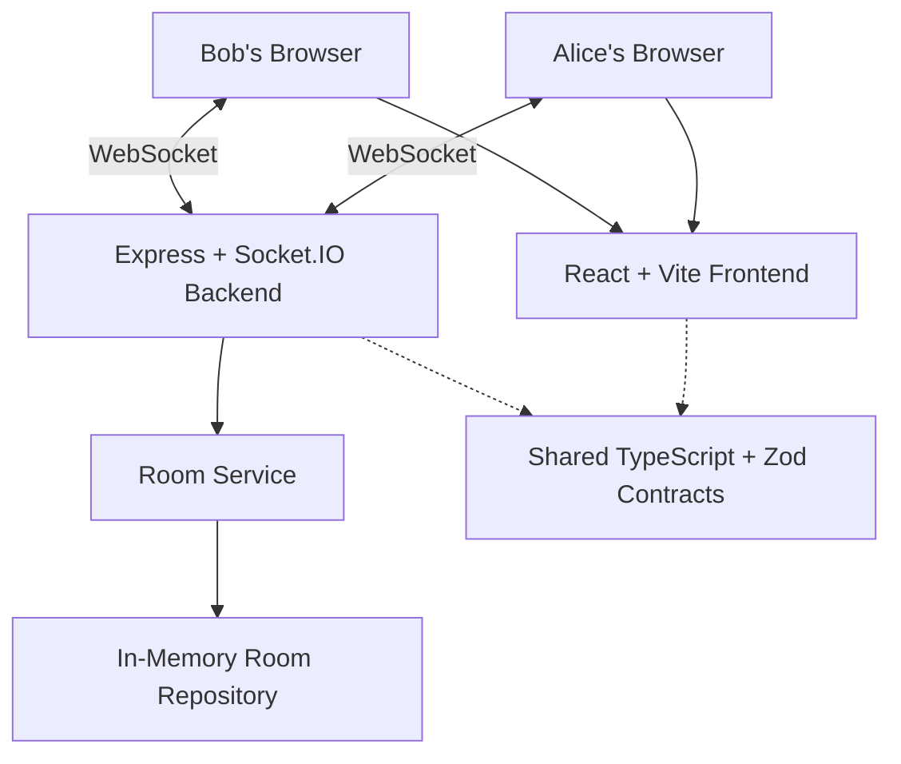
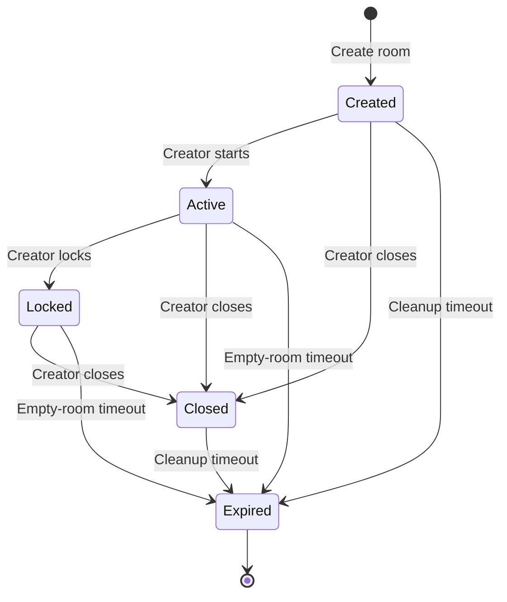

## Backend Architecture

ChatRoom follows a layered architecture to separate networking, business logic, and data storage.

### Socket Handlers

Located in `apps/server/src/socket/`.

Responsibilities:

- Receive Socket.IO events.
- Validate incoming payloads.
- Enforce socket-session and room membership requirements.
- Call application services.
- Return typed acknowledgements.
- Broadcast updates to connected participants.

### Room Service

Located in `apps/server/src/services/room.service.ts`.

Responsibilities:

- Create and start rooms.
- Join and leave rooms.
- Enforce room capacity and lifecycle rules.
- Lock and close rooms.
- Validate message operations.
- Manage participant presence.
- Coordinate room state changes.

### Repository Layer

Located in `apps/server/src/repositories/`.

Responsibilities:

- Store room records.
- Retrieve rooms and participants.
- Update room status.
- Store temporary messages.
- Delete expired rooms.

The current implementation uses an in-memory repository.

### Shared Package

Located in `packages/shared/`.

Responsibilities:

- Define room and participant types.
- Define Socket.IO event contracts.
- Define acknowledgement results and error codes.
- Provide Zod validation schemas.
- Share application constants between frontend and backend.

### Design Benefits

- Business logic is separated from transport logic.
- Validation contracts are shared.
- Room operations can be tested independently.
- The repository can be replaced without rewriting the entire application.
- Socket.IO acknowledgements provide consistent success and error handling.



## Technical Decisions and Trade-offs

ChatRoom was designed as a lightweight, real-time chat application with an emphasis on maintainability, type safety, security, and testability.

The following decisions shaped its architecture.

### 1. Socket.IO for Real-Time Communication

**Decision:** Use Socket.IO for bidirectional communication between the React frontend and Node.js backend.

**Why:**
- Supports event-driven communication.
- Provides typed acknowledgements for request-response operations.
- Supports broadcasting messages to room participants.
- Includes connection and disconnection events.
- Provides reconnection mechanisms.

**Trade-offs:**
- Requires persistent connections to the backend.
- Adds complexity compared with a traditional REST API.
- Scaling across multiple server instances requires additional infrastructure.

**Alternative considered:** Native WebSockets.

Socket.IO was selected because its event abstraction, acknowledgements, and room broadcasting simplify the implementation of real-time chat.

### 2. TypeScript Across the Full Stack

**Decision:** Use TypeScript for both frontend and backend development.

**Why:**
- Provides compile-time type checking.
- Improves editor autocomplete and refactoring.
- Helps prevent mismatches between client and server contracts.
- Makes complex room and participant state easier to maintain.

**Trade-offs:**
- Requires a compilation step.
- Adds complexity to project configuration.
- TypeScript types alone do not validate untrusted runtime data.

**Alternative considered:** JavaScript.

TypeScript was chosen to improve reliability as the application grows.

### 3. Zod for Runtime Validation

**Decision:** Use Zod to validate incoming Socket.IO payloads.

**Why:**
- Validates untrusted input at runtime.
- Provides reusable validation schemas.
- Supports consistent validation across frontend and backend.
- Helps reject malformed room codes, display names, and messages.

**Trade-offs:**
- Introduces an additional dependency.
- Requires schemas to be maintained as requirements change.

**Alternative considered:** Manual validation functions.

Zod was selected to provide consistent and maintainable validation rules.

### 4. npm Workspaces for Monorepo Management

**Decision:** Organize ChatRoom as an npm-workspaces monorepo.

```text
ChatRoom/
├── apps/
│   ├── client/
│   └── server/
├── packages/
│   └── shared/
└── package.json
```

**Why:**
- Keeps frontend and backend in one repository.
- Enables code sharing without publishing separate npm packages.
- Centralizes dependency installation.
- Makes coordinated changes easier.

**Trade-offs:**
- Requires workspace-aware build commands.
- Shared packages must be built before dependent applications.
- Cloud deployment requires careful root-directory configuration.

**Alternative considered:** Separate frontend and backend repositories.

The monorepo approach was chosen to simplify development and enable shared contracts.

### 5. Shared TypeScript Contracts

**Decision:** Define Socket.IO events, room types, participant types, error codes, and validation schemas in `@chatroom/shared`.

**Why:**
- Establishes a common contract between frontend and backend.
- Reduces duplicated type definitions.
- Makes breaking API changes easier to detect.
- Improves type safety for Socket.IO acknowledgements.

**Trade-offs:**
- Both applications depend on the shared package.
- Contract changes may require coordinated frontend and backend updates.

This approach provides a single source of truth for application communication.

### 6. Layered Backend Architecture

**Decision:** Separate Socket.IO handlers, application services, and repository operations.

```text
Socket.IO Handlers
        |
        v
   Room Service
        |
        v
 Room Repository
```

**Why:**
- Keeps transport-specific logic separate from business rules.
- Makes services easier to test.
- Allows repository implementations to change independently.
- Improves code organization and maintainability.

**Trade-offs:**
- Requires additional interfaces and files.
- Introduces some abstraction overhead for a small application.

The layered design was selected to support testing and future extensions.

### 7. In-Memory Room Repository

**Decision:** Store rooms, participants, and messages in memory.

**Why:**
- Fits the temporary-room concept.
- Provides fast access to active room state.
- Avoids database setup and operational complexity.
- Keeps the initial implementation lightweight.

**Trade-offs:**
- Data is lost when the backend restarts.
- Rooms cannot be shared reliably across multiple server instances.
- Message history is not durable.
- Backend redeployments invalidate active rooms.

**Alternative considered:** PostgreSQL or MongoDB.

An in-memory repository was selected for the MVP. Persistent storage can be introduced later through the existing repository abstraction.

### 8. React Context for Client Session Management

**Decision:** Use React Context to manage the active room session and related actions.

**Why:**
- Shares session state across routed components.
- Avoids passing session data through multiple component levels.
- Centralizes room creation, joining, and creator operations.
- Works without introducing an additional state-management library.

**Trade-offs:**
- Session state is lost when the page refreshes.
- Context updates can cause consuming components to re-render.
- Automatic session restoration is not currently supported.

**Alternative considered:** Redux Toolkit or Zustand.

React Context was sufficient for the scope of the MVP.

### 9. Creator Token Authorization

**Decision:** Use a creator token to authorize creator-only room operations.

**Why:**
- Distinguishes the creator from regular participants.
- Prevents ordinary members from starting, locking, or closing rooms.
- Avoids requiring permanent user accounts.
- Supports temporary room ownership.

**Trade-offs:**
- Creator tokens must remain confidential.
- Token possession is security-sensitive.
- The current application does not restore creator sessions after refresh or disconnection.

**Security considerations:**
- Validate creator authorization on the server.
- Do not trust client-provided role information.
- Do not expose creator tokens in public URLs.
- Avoid logging creator tokens.

### 10. Rate Limiting and Input Protection

**Decision:** Apply server-side rate limiting, payload validation, and Socket.IO payload-size restrictions.

**Why:**
- Reduces excessive room creation and join attempts.
- Limits message flooding.
- Protects server resources.
- Rejects malformed or oversized payloads.

**Trade-offs:**
- Legitimate users may occasionally encounter rate limits.
- Limits require tuning based on usage patterns.
- In-memory rate-limit state is local to each backend instance.

Rate limiting complements authorization and validation but does not replace either.

### 11. Automatic Room Lifecycle Cleanup

**Decision:** Automatically remove unused or expired rooms.

**Why:**
- Prevents temporary rooms from accumulating indefinitely.
- Reduces memory consumption.
- Keeps the application aligned with its ephemeral design.
- Handles rooms abandoned by disconnected participants.

**Trade-offs:**
- Cleanup timing depends on configured expiration thresholds.
- Room state disappears permanently when a room is removed.
- Cleanup scheduling requires careful testing.

The lifecycle service separates expiration rules from Socket.IO transport behavior.

### 12. Node.js Test Runner for Backend Tests

**Decision:** Use the built-in Node.js test runner for backend unit and integration tests.

**Why:**
- Avoids introducing a large additional testing framework.
- Supports assertions and asynchronous tests.
- Works with compiled JavaScript.
- Provides sufficient functionality for service and Socket.IO integration testing.

**Trade-offs:**
- Some advanced testing features require additional setup.
- Tests must follow the project's compilation and module-resolution conventions.

### 13. Playwright for End-to-End Testing

**Decision:** Use Playwright to test real browser workflows.

**Why:**
- Tests actual user interactions.
- Supports desktop and mobile viewports.
- Can simulate multiple independent browser sessions.
- Helps verify routing, room creation, joining, and real-time messaging.

**Trade-offs:**
- Browser tests are slower than unit tests.
- Require browser binaries and a running application.
- Can be affected by timing and environment configuration.

Playwright complements backend tests by validating the complete application workflow.

### 14. In-Memory Application Metrics

**Decision:** Track connection counts and event outcomes using a lightweight metrics service.

**Why:**
- Provides visibility into active connections.
- Tracks successful and failed room operations.
- Helps identify rate-limit activity.
- Avoids requiring a separate monitoring infrastructure for the MVP.

**Trade-offs:**
- Metrics reset on backend restart.
- Metrics are not aggregated across server instances.
- Historical analysis is limited.

A dedicated metrics backend could be introduced if the application grows.

### 15. Separate Frontend and Backend Deployment

**Decision:** Deploy the frontend to Vercel and the backend to Render.

**Why:**
- Vercel supports static Vite frontend deployment.
- Render supports a long-running Node.js server with Socket.IO connections.
- Frontend and backend can be deployed independently.
- Environment variables configure the connection between services.

**Trade-offs:**
- Requires cross-origin configuration.
- Environment variables must remain synchronized.
- Deployment introduces network latency.
- Backend restarts interrupt active room sessions.

The architecture is suitable for a single-instance portfolio MVP.

---

## Architectural Limitations

The current implementation intentionally prioritizes simplicity and temporary communication over persistence and horizontal scalability.

| Limitation | Current behavior | Potential improvement |
|---|---|---|
| In-memory storage | Rooms disappear on restart | PostgreSQL or MongoDB |
| Single backend instance | No shared room state | Redis and shared storage |
| Session restoration | Refresh loses active session | Reconnection tokens and session recovery |
| Message persistence | No durable history | Database-backed messages |
| Monitoring | In-memory metrics and structured logs | Prometheus and Grafana |
| Authentication | Temporary participant identities | Optional account authentication |
| High availability | Backend restart interrupts sessions | Multi-instance deployment and recovery |

## Future Architecture

If ChatRoom needs to support more users and persistent conversations, the architecture could evolve toward:

```text
React Frontend
      |
      v
Load Balancer
      |
      v
Multiple Socket.IO Servers
      |
      +---- Redis Adapter
      |
      +---- Shared Database
      |
      +---- Centralized Monitoring
```

This would require changes to session recovery, distributed rate limiting, room storage, and Socket.IO coordination.

## Conclusion

ChatRoom demonstrates the use of a layered, type-safe architecture for building real-time applications.

The key engineering priorities were:

- Reliable real-time communication
- Shared client-server contracts
- Server-side authorization and validation
- Testable business logic
- Controlled room lifecycle management
- Responsive frontend workflows
- Deployment and operational visibility

The current architecture provides a practical foundation for an ephemeral chat MVP while leaving clear extension points for persistence, scalability, and improved session recovery.
