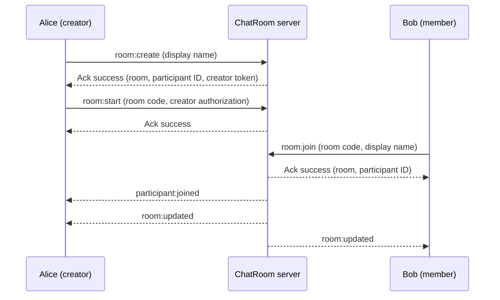
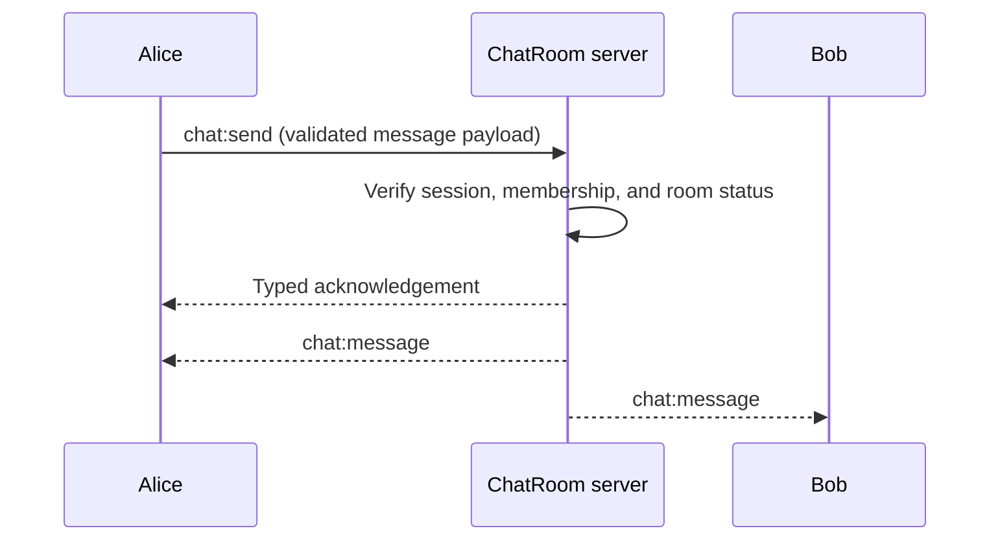
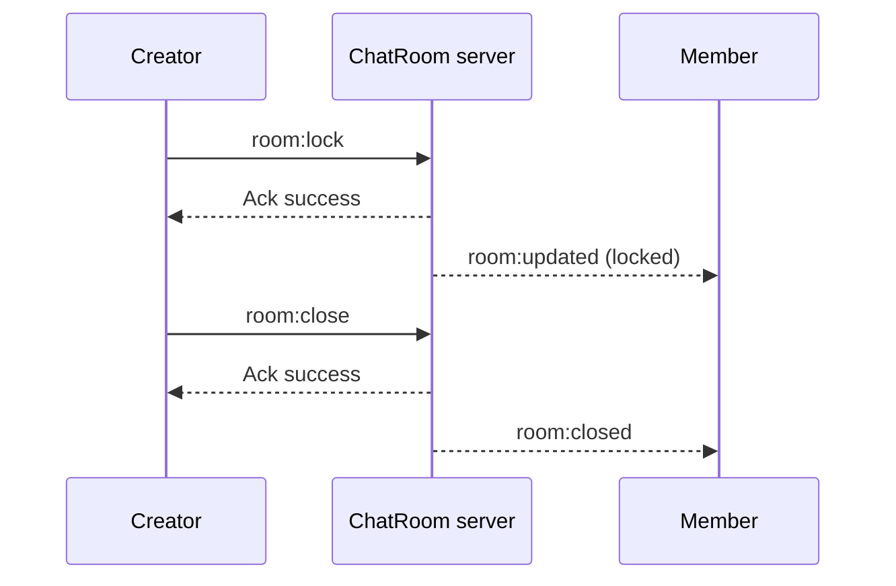

# ChatRoom — Socket.IO Event Reference

This document describes the real-time events exchanged between the ChatRoom React client and the Express/Socket.IO server.

> **Source of truth:** `packages/shared/src/socket-events.ts`, `packages/shared/src/room.ts`, `packages/shared/src/errors.ts`, and `packages/shared/src/schemas.ts`. Review these files when changing event names, payload fields, or response types. The examples below are illustrative, not a substitute for the shared TypeScript contracts.

## 1. Communication model

The client emits named Socket.IO events and receives typed acknowledgements. The server broadcasts updates to relevant room participants.

- **Client → server:** commands such as creating a room, joining a room, or sending a message.
- **Server → client:** notifications such as room updates, participant changes, and new messages.
- **Acknowledgements:** a command returns either a typed success result or a structured error.
- **Authorization:** the server validates payloads and verifies room membership and creator privileges; client-provided data is never sufficient on its own to establish authorization.

## 2. Client-to-server events

| Event | Purpose | Expected authorization | Notes |
| --- | --- | --- | --- |
| `room:create` | Create a temporary room | Eligible socket without an existing room session | Returns room information and creator credentials; keep the creator token private. |
| `room:start` | Transition a created room to active | Room creator | Requires creator authorization. |
| `room:join` | Join an active room using a room code | Eligible socket | Subject to room status, capacity, and validation. |
| `room:lock` | Prevent new participants from joining | Room creator | Existing participants can continue according to room rules. |
| `room:leave` | Leave the current room | Current participant | Releases membership for that participant. |
| `room:close` | Close the room | Room creator | Notifies participants and prevents further activity. |
| `chat:send` | Send a message to a room | Current authorized participant | Subject to message validation and rate limits. |

**Implementation note:** If later stories introduced events such as unlocking a room or restoring a session, add their exact names and payloads from the current shared contract.

## 3. Server-to-client events

| Event | Purpose | Client handling |
| --- | --- | --- |
| `room:updated` | Room state or summary changed | Refresh room status, counts, and relevant UI. |
| `participant:joined` | A participant joined | Update participant list and presence indicators. |
| `participant:left` | A participant left or their presence changed | Update the participant list/presence UI using the actual event payload. |
| `room:closed` | Room was closed | Disable room interactions and show a closure notice. |
| `chat:message` | A new chat message was delivered | Append the message if it belongs to the current room. |

> Check `ServerToClientEvents` for additional events, including any presence notifications added after the initial implementation.

## 4. Typed acknowledgement contract

Commands use a discriminated union:

```ts
type AckResult<T> =
  | {
      success: true;
      data: T;
    }
  | {
      success: false;
      error: {
        code: string; // Actual application error-code union is defined in shared.
        message: string;
      };
    };
```

### Successful acknowledgement

For example, a successful `room:join` acknowledgement can include the room summary and the joining participant's ID:

```json
{
  "success": true,
  "data": {
    "room": {
      "code": "ABC123",
      "status": "active",
      "participantCount": 2,
      "maxParticipants": 20,
      "createdAt": "2026-11-12T10:00:00.000Z",
      "startedAt": "2026-11-12T10:01:00.000Z"
    },
    "participantId": "example-participant-id"
  }
}
```

The exact result shape for each event is specified by the shared types. In particular, `room:create` also returns a **creator token**; do not include real tokens in documentation, screenshots, or logs.

### Failed acknowledgement

```json
{
  "success": false,
  "error": {
    "code": "ROOM_NOT_FOUND",
    "message": "Room not found"
  }
}
```

Common error codes include:

| Code | Meaning |
| --- | --- |
| `INVALID_PAYLOAD` | The supplied event payload failed validation. |
| `ROOM_NOT_FOUND` | The requested room does not exist. |
| `ROOM_NOT_ACTIVE` | The room is not yet available for the requested operation. |
| `ROOM_LOCKED` | The room is locked against new joins. |
| `ROOM_CLOSED` | The room is closed. |
| `ROOM_FULL` | The room has reached its participant limit. |
| `NOT_AUTHORIZED` | The socket or participant lacks permission. |
| `PARTICIPANT_NOT_FOUND` | The requested participant cannot be found. |
| `ALREADY_STARTED` | The room was already started. |
| `RATE_LIMITED` | The operation exceeded an enforced rate limit. |
| `INTERNAL_ERROR` | An unexpected server error occurred. |

Use the error code for client-side decisions and the user-facing message for display. Do not expose internal stack traces to clients.

## 5. Example workflows

### Create, start, and join



### Real-time messaging



Whether the sender also receives the broadcast depends on the current server implementation. Check `apps/server/src/socket/chat.handlers.ts` before relying on this detail.

### Lock and close



## 6. Room lifecycle and operation rules

| Room status | Join allowed? | Send messages? | Creator action |
| --- | --- | --- | --- |
| `created` | No | No | Start or close. |
| `active` | Yes, subject to capacity | Yes, for authorized members | Lock or close. |
| `locked` | No new joins | Yes, for existing authorized members | Close (and unlock if supported). |
| `closed` | No | No | No further room activity. |

These rules summarize the intended workflow. Consult `apps/server/src/services/room.service.ts` for authoritative enforcement.

## 7. Security requirements

1. Validate incoming event payloads using the shared Zod schemas.
2. Verify socket-session membership before processing room or chat commands.
3. Require creator authorization for creator-only operations.
4. Never trust client-provided roles as proof of privilege.
5. Apply configured rate limits and payload-size limits.
6. Do not put creator tokens in URLs, browser screenshots, or server logs.
7. Do not log full chat messages or raw event payloads.
8. Return structured errors without revealing internal implementation details.

## 8. Contract maintenance checklist

When adding or changing a Socket.IO event:

- [ ] Update the event types in `packages/shared/src/socket-events.ts`.
- [ ] Update the corresponding Zod schema and result types if needed.
- [ ] Update the server handler and service authorization rules.
- [ ] Update the React client listener or emitter.
- [ ] Add or update backend integration tests.
- [ ] Update this document with the exact event name, payload, acknowledgement, and broadcast behavior.

## 9. Related source files

- `packages/shared/src/socket-events.ts` — typed event map.
- `packages/shared/src/room.ts` — room summaries and result types.
- `packages/shared/src/errors.ts` — acknowledgement/error contracts.
- `packages/shared/src/schemas.ts` — runtime validation.
- `apps/server/src/socket/room.handlers.ts` — room event handling.
- `apps/server/src/socket/chat.handlers.ts` — message event handling.
- `apps/server/src/socket/presence.handlers.ts` — disconnect and presence handling.
- `apps/server/src/services/room.service.ts` — business rules.
